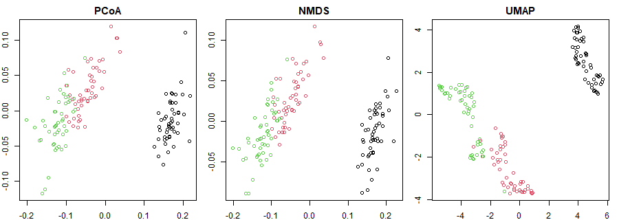

# ecodive 

<!-- badges: start -->
[](https://CRAN.R-project.org/package=ecodive)
[](https://anaconda.org/conda-forge/r-ecodive)
[](https://app.codecov.io/gh/cmmr/ecodive)
[](https://doi.org/10.21105/joss.09777)
<!-- badges: end -->

`ecodive` is an R package for ecological diversity analysis, from a count
table to figures and p-values: alpha and beta diversity, ordination, and
permutation tests, all in parallelized and memory-efficient C. It is designed
to handle large datasets, such as those common in microbiome research.


## Why ecodive?

Analyzing ecological diversity is often a computational bottleneck, especially
with large datasets. `ecodive` addresses this by providing:

* **High Performance:** `ecodive` is written in C and parallelized using pthreads, making it dramatically faster than other R packages. [Benchmarks](https://cmmr.github.io/ecodive/articles/benchmark.html) show it can be up to **14,000x faster** and use up to **200,000x less memory**.

* **Zero Dependencies:** The package has no external R dependencies, making it lightweight, stable, and easy to install. This also makes it an ideal and secure backend for other R packages.

* **Comprehensive Metrics:** It implements 14 alpha and 38 beta diversity metrics, including classic and phylogenetic-aware methods like **Faith's PD**, the **complete UniFrac family** and the compositional **PhILR distance**.

* **Ordination and Statistics:** Ten ordination methods (PCoA, NMDS, UMAP, t-SNE, db-RDA, robust Aitchison PCA, and more), biplots, and five permutation tests (PERMANOVA, PERMDISP, ANOSIM, MRPP, and Mantel), so a whole analysis needs no other package.

* **Trusted Results:** Every method is tested against the established package it replaces, such as `vegan`, `ape`, `scikit-bio`, `scikit-learn`, `uwot`, and `gemelli`. Results are identical for any number of threads, and random methods take a `seed`.

* **Ease of Use:** The API is simple and integrates seamlessly with popular bioinformatics packages like [`phyloseq`](http://joey711.github.io/phyloseq/) and [`rbiom`](https://cmmr.github.io/rbiom/).


## What's Included

| Task                     | Wrapper           | Functions                                                                                                                                                 |
| :----------------------- | :---------------- | :-------------------------------------------------------------------------------------------------------------------------------------------------------- |
| Alpha diversity          | `alpha_div()`     | `shannon()`, `simpson()`, `chao1()`, `faith()`, `pielou()`, `hill()`, and 19 more                                                                         |
| Beta diversity           | `beta_div()`      | `bray()`, `jaccard()`, `aitchison()`, `weighted_unifrac()`, and 42 more                                                                                   |
| Ordination               | `dist_ord()`      | `pcoa()`, `mds()`, `nmds()`, `isomap()`, `tsne()`, `umap()`, `dbrda()`, `capscale()`, `capda()`                                                           |
| Ordination of counts     | `count_ord()`     | `pca()`, `rpca()`, `rpca_phylo()`, `dpcoa()`, `rda()`, `cca()`, `ca()`, `lda()`, `plsda()`, `oplsda()`                                                    |
| Biplots                  |                   | `pcoa_biplot()`, `envfit()`                                                                                                                               |
| Comparing ordinations    |                   | `procrustes()`, `procrustes_test()`                                                                                                                       |
| Model building           |                   | `varpart()`, `forward_select()`, `bioenv()`, `principal_response_curves()`, `mantel_regression()`                                                         |
| Statistical tests        | `dist_test()`     | `permanova()`, `permdisp()`, `anosim()`, `mrpp()`, `mantel()`, `mantel_partial()`                                                                         |
| Interpreting differences |                   | `simper()`                                                                                                                                                |
| Spatial                  |                   | `moran_i()`, `dbmem()`, `mantel_correlogram()`                                                                                                            |
| Differential abundance   | `da_test()`       | `ancom()`, `ancombc()`, `linda()`, `maaslin3()`, `dirmult_ttest()`, `dirmult_lm()`, `lefse()`, `indicator_species()`, `da_wilcoxon()`, `da_sensitivity()` |
| Compositional data       | `replace_zeros()` | `replace_zeros_mult()`, `replace_zeros_gbm()`, `replace_zeros_sq()`, `replace_zeros_bl()`, `replace_zeros_czm()`, `alr()`, `ilr()`, `philr()`, `log_ratio()`, `balance()`, `log_ratio_features()`, `variation_array()`, `zero_pattern()` |
| Feature associations     | `feature_assoc()` | `vlr()`, `rho_p()`, `phi_s()`, `sparcc()`, `assoc_pairs()`, `assoc_network()`, `cross_assoc()`                                                            |
| Absolute abundance       |                   | `qmp_scale()`, `qmp_rarefy()`                                                                                                                             |
| Community types          |                   | `enterotype()`, `valencia()`, `dmm()`                                                                                                                     |
| Source tracking          |                   | `sourcetracker()`                                                                                                                                         |
| Quality control          |                   | `decontam()`                                                                                                                                              |
| Community assembly       |                   | `neutral_model()`                                                                                                                                         |
| Longitudinal             |                   | `first_differences()`, `first_distances()`, `volatility()`, `nmit()`, `feature_volatility()`                                                              |
| Batch correction         |                   | `batch_mmuphin()`, `batch_combat()`                                                                                                                       |
| Prediction               |                   | `random_forest()`                                                                                                                                         |
| Plotting                 |                   | `plot()` of distance matrices, ordinations, tests, and the other results; `composition_barplot()`, `ternary_plot()`                                       |
| Data preparation         |                   | `rarefy()`, `rarefaction_curve()`, `normalize()`, `read_tree()`                                                                                           |

Each wrapper runs its functions by name, such as `beta_div(counts, 'bray')`
or `dist_ord(dm, 'nmds')`.


## Installation

The latest stable version can be installed from CRAN.

``` r
install.packages('ecodive')
```

The development version is available on GitHub.

``` r
install.packages('pak')
pak::pak('cmmr/ecodive')
```


## Usage

`ecodive` functions are straightforward to use. Here are a few examples.


### With `phyloseq` or `rbiom` objects

The easiest way to use `ecodive` is with a `phyloseq`, `rbiom`, or 
`TreeSummarizedExperiment` object. These objects conveniently bundle 
the count data and phylogenetic tree.

``` r
library(ecodive)
data(esophagus, package = 'phyloseq')
hmp50 <- rbiom::hmp50

# Calculate weighted UniFrac distance
w_unifrac <- weighted_unifrac(esophagus)
w_unifrac
#> # A dist: 3 samples (lower triangle)
#> # Weighted UniFrac
#>       B     C
#> C 0.105
#> D 0.14  0.142
#> # Attributes: method

# Calculate Faith's Phylogenetic Diversity
faith_pd <- faith(hmp50)
faith_pd[1:4]
#>   HMP01   HMP02   HMP03   HMP04 
#> 6.22296 8.59432 8.93375 9.86597
```


### With basic R objects

You can also provide the count data and phylogenetic tree as separate objects.

The `ex_counts` and `ex_tree` objects are included with `ecodive`.

``` r
## Example Data ----------------------
counts <- rarefy(ex_counts)
counts[,1:4]
#>        Streptococcus Bacteroides Corynebacterium Haemophilus
#> Saliva           162           2               0         180
#> Gums             309           2               0          34
#> Nose               6           0             171           0
#> Stool              1         341               1           1


## Alpha Diversity -------------------
shannon(counts)
#>     Saliva       Gums       Nose      Stool 
#> 0.74119910 0.35692121 1.10615349 0.07927797

faith(counts, tree = ex_tree)
#> Saliva   Gums   Nose  Stool 
#>    180    155    101    202


## Beta Diversity --------------------
bray(counts)
#> # A dist: 4 samples (lower triangle)
#> # Bray-Curtis Dissimilarity
#>       Saliva  Gums  Nose
#> Gums   0.426
#> Nose   0.98  0.983
#> Stool  0.988 0.988 0.991
#> # Attributes: method

weighted_unifrac(counts, tree = ex_tree)
#> # A dist: 4 samples (lower triangle)
#> # Weighted UniFrac
#>       Saliva Gums Nose
#> Gums    37
#> Nose    67.2   56
#> Stool  110    109  110
#> # Attributes: method
```


### Ordination

Ordinations place samples on a few axes for plotting. Most start from beta
diversity distances; `pca()`, `rpca()`, `rda()`, `cca()`, `ca()`, `lda()`, `plsda()` and `oplsda()` start from the counts. With only
four samples, `ex_counts` is too small to ordinate, so these examples use
R's built-in `iris` data: 150 flowers from three species.

``` r
dm <- bray(iris[, 1:4])

ord <- pcoa(dm)
ord
#> # A matrix: 150 samples × 3 axes
#> # Principal Coordinates Analysis of Bray-Curtis Dissimilarity
#> # % of variance: 89.0, 9.3, 2.9
#>    PCoA1   PCoA2    PCoA3
#>  1 0.169 -0.0259 -0.00505
#>  2 0.171  0.0235  0.0308
#>  3 0.187 -0.0032  0.0322
#>  4 0.18   0.0113  0.0372
#>  5 0.176 -0.03   -0.00613
#>  6 0.136 -0.0398 -0.0431
#>  7 0.186 -0.0182  0.0156
#>  8 0.167 -0.0165  0.00287
#>  9 0.194  0.0406  0.0413
#> 10 0.171  0.011   0.0286
#> # … 140 more samples
#> # Use print(x, n = ...) to see more samples
#> # Attributes: method, eig, prop, trace, correction, constant

# Any method by name, coloured by a column of metadata.
plot(dist_ord(dm, 'pcoa'), 'Species', iris)
plot(dist_ord(dm, 'nmds'), 'Species', iris)
plot(dist_ord(dm, 'umap'), 'Species', iris)
```




### Statistical Tests

Permutation tests ask whether a variable, such as species or treatment,
explains the distances between samples.

``` r
permanova(dm, 'Species', iris)
#> Permutational multivariate analysis of variance (PERMANOVA) of Bray-Curtis Dissimilarity
#> 
#> F = 532.7, p = 0.001, z = 577.6
#> Permutations: 999 (free)
#> 
#> Model R2 = 0.8788. Model tested as a whole:
#> 
#>           Df SumOfSqs     R2     F Pr(>F)    
#> Model      2   2.3173 0.8788 532.7  0.001 ***
#> Residual 147   0.3197 0.1212                 
#> Total    149   2.6370 1.0000                 
#> ---
#> Signif. codes:  0 '***' 0.001 '**' 0.01 '*' 0.05 '.' 0.1 ' ' 1

# Any test by name.
dist_test(dm, 'anosim', 'Species', iris)
#> Analysis of similarities (ANOSIM) of Bray-Curtis Dissimilarity
#> 
#> R = 0.8576, p = 0.001, z =  79.4
#> Permutations: 999 (free)
#> 
#> Mean rank of the distances, between and within groups:
#>            pairs mean_rank
#> Between     7500   7163.90
#> setosa      1225   2239.66
#> versicolor  1225   2457.85
#> virginica   1225   2418.15
```


## Available Methods

Use `list_metrics()` to browse the metrics available for calculating
diversity, `list_dist_ords()` for ordination methods, and `list_dist_tests()`
for statistical tests.

``` r
# Alpha Diversity
list_metrics('alpha', 'id')
#>  [1] "ace"               "berger"            "brillouin"        
#>  [4] "chao1"             "faith"             "fisher"           
#>  [7] "gini"              "simpson"           "goods_coverage"   
#> [10] "heip"              "hill"              "inv_simpson"      
#> [13] "margalef"          "mcintosh"          "mcintosh_evenness"
#> [16] "menhinick"         "observed"          "pielou"           
#> [19] "renyi"             "shannon"           "dominance"        
#> [22] "simpson_evenness"  "squares"           "strong"           
#> [25] "tsallis"          

# Beta Diversity
list_metrics('beta', 'id')
#>  [1] "aitchison"                 "bhattacharyya"            
#>  [3] "bray"                      "canberra"                 
#>  [5] "chebyshev"                 "chord"                    
#>  [7] "clark"                     "sorensen"                 
#>  [9] "divergence"                "euclidean"                
#> [11] "generalized_unifrac"       "gower"                    
#> [13] "hamming"                   "hellinger"                
#> [15] "horn"                      "jaccard"                  
#> [17] "jensen"                    "jsd"                      
#> [19] "lorentzian"                "manhattan"                
#> [21] "matusita"                  "minkowski"                
#> [23] "morisita"                  "motyka"                   
#> [25] "normalized_unifrac"        "ochiai"                   
#> [27] "philr_distance"            "psym_chisq"               
#> [29] "robust_aitchison"          "soergel"                  
#> [31] "squared_chisq"             "squared_chord"            
#> [33] "squared_euclidean"         "topsoe"                   
#> [35] "unweighted_unifrac"        "variance_adjusted_unifrac"
#> [37] "wave_hedges"               "weighted_unifrac"

# Ordination methods that take distances
list_dist_ords('id')
#> [1] "capda"    "capscale" "dbrda"    "isomap"   "mds"      "nmds"     "pcoa"    
#> [8] "tsne"     "umap"

# Statistical tests
list_dist_tests('id')
#> [1] "anosim"         "mantel"         "mantel_partial" "mrpp"          
#> [5] "permanova"      "permdisp"
```


## Documentation

The online manual for ecodive is available at
<https://cmmr.github.io/ecodive/>. It includes reference pages for each
function and these guides, which are also available offline with
`vignette()`:

* [Introduction to ecodive](https://cmmr.github.io/ecodive/articles/ecodive.html) - `vignette('ecodive')`
* [Alpha Diversity](https://cmmr.github.io/ecodive/articles/adiv.html) - `vignette('adiv')`
* [Beta Diversity](https://cmmr.github.io/ecodive/articles/bdiv.html) - `vignette('bdiv')`
* [Ordination](https://cmmr.github.io/ecodive/articles/ordination.html) - `vignette('ordination')`
* [Statistical Tests](https://cmmr.github.io/ecodive/articles/stat_tests.html) - `vignette('stat_tests')`
* [Performance](https://cmmr.github.io/ecodive/articles/performance.html) - `vignette('performance')`


## Community guidelines


### Support

Bug reports, feature requests, and general questions can be submitted at
<https://github.com/cmmr/ecodive/issues>.


### Contributing

Pull requests are welcome. Please ensure contributed code is covered by
tests and documentation (add additional tests and documentation as
needed) and passes all automated tests.

New functions must leverage C and pthreads to minimize memory and CPU time.

Please note that the ecodive project is released with a [Contributor Code of
Conduct](https://cmmr.github.io/ecodive/CODE_OF_CONDUCT.html). By contributing
to this project, you agree to abide by its terms.


## Citation

If you use `ecodive` in your research, please cite our paper:

Smith et al., (2026). ecodive: Parallel and Memory-Efficient R Package for Ecological Diversity Analysis. *Journal of Open Source Software*, 11(121), 9777, https://doi.org/10.21105/joss.09777


## License

`ecodive` is licensed under the [MIT License](https://opensource.org/license/mit) &copy; 2026 ecodive authors.

This package also contains third-party code:

* [**PCG Random Number Generation for C**](https://www.pcg-random.org): Licensed under the [Apache License, Version 2.0](https://opensource.org/license/apache-2.0).
* [**scikit-learn**](https://scikit-learn.org) (SMACOF for MDS and NMDS, t-SNE, and Isomap): Licensed under the [BSD 3-Clause License](https://opensource.org/license/bsd-3-clause).
* [**scikit-bio**](https://scikit.bio) (PCoA biplot scores): Licensed under the [BSD 3-Clause License](https://opensource.org/license/bsd-3-clause).
* [**gemelli**](https://github.com/biocore/gemelli) (robust Aitchison PCA): Licensed under the [BSD 3-Clause License](https://opensource.org/license/bsd-3-clause).
* [**uwot**](https://github.com/jlmelville/uwot) (UMAP): Licensed under the [BSD 2-Clause License](https://opensource.org/license/bsd-2-clause).

Detailed copyright and licensing information for all components can be found in the [`inst/COPYRIGHTS`](https://github.com/cmmr/ecodive/blob/main/inst/COPYRIGHTS) file.
