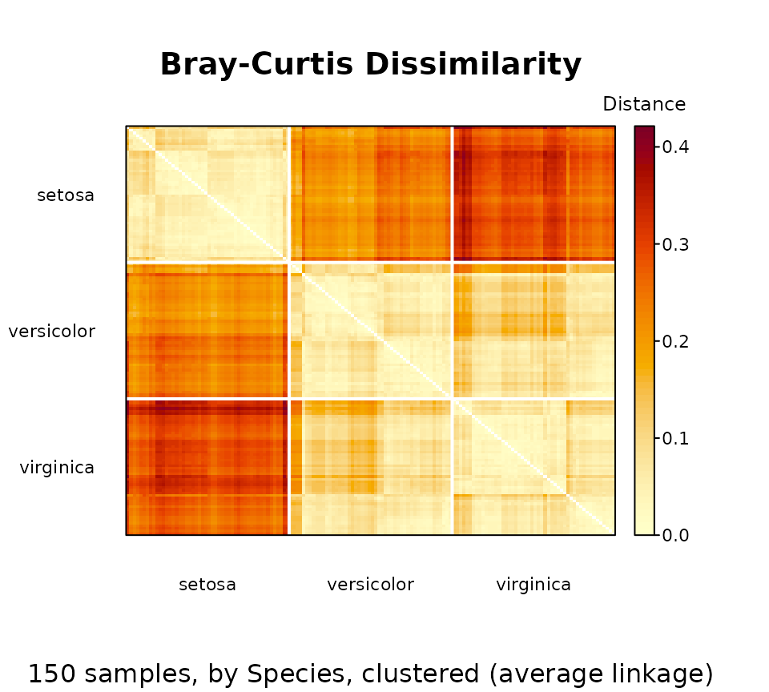
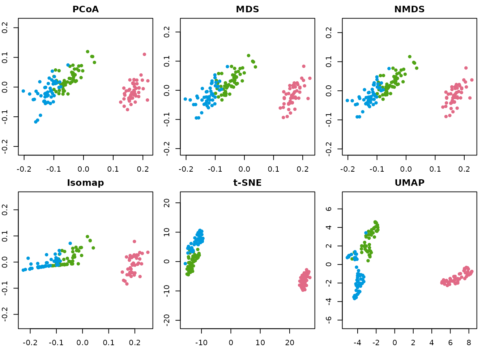
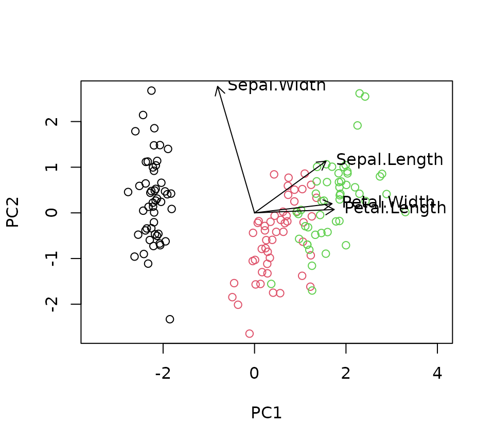
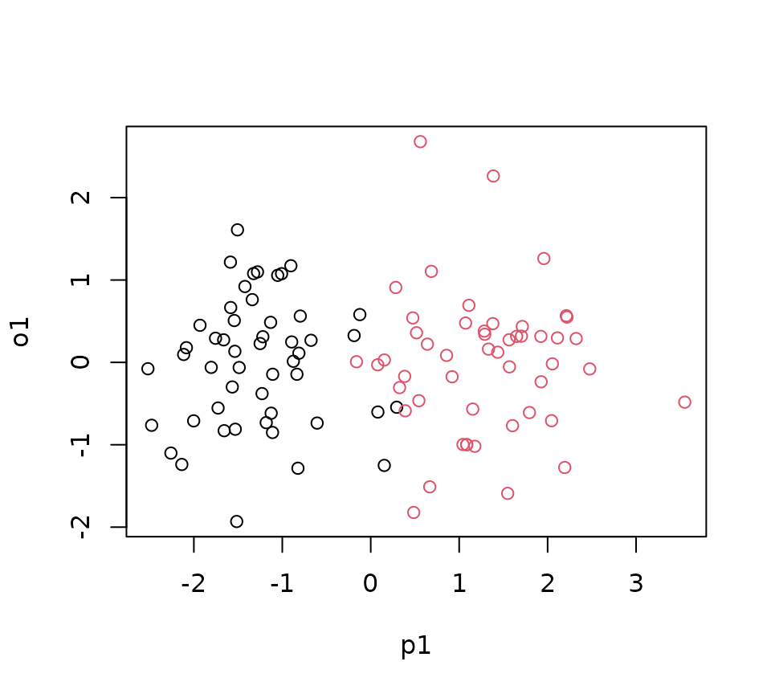
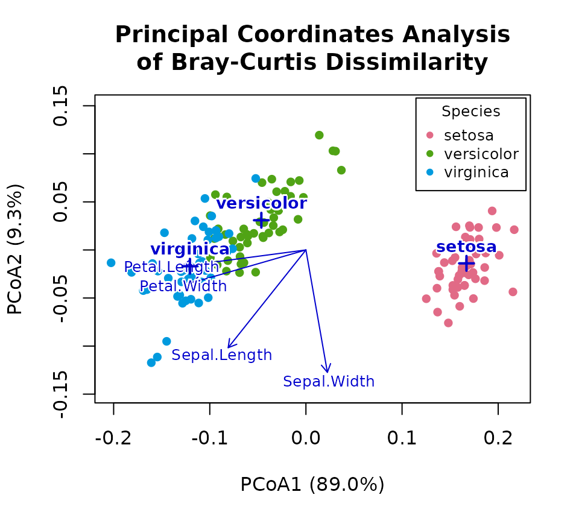

# Ordination

## Introduction

An ordination places samples on a few axes so that similar samples land
near each other, ready to plot. ecodive has eleven ordination methods,
and two functions that show which features or variables drive the axes.
All of them are written in parallel C and give the same results as the R
and Python packages they replace, for any number of threads.

Most methods ordinate a distance matrix, which you compute first with
any beta diversity metric. Three methods, PCA, robust Aitchison PCA and
redundancy analysis, start from the count table itself.

                     bray(), beta_div(), ...
      count table  ────────────────────────►  dm  ──►  dist_ord(dm, 'pcoa')
           │                                           pcoa(dm), nmds(dm), umap(dm), ...
           │                                           dist_test(dm, 'permanova', ...)
           │
           └─────────────────────────────────────────►  count_ord(counts, 'pca')
                                                       pca(counts), rpca(counts)

The examples here use R’s built-in `iris` data: 150 flowers (the
samples), four measurements of each (the features), and three species.
Your own data can be any count table that ecodive takes, such as a
matrix, a sparse matrix, or a `phyloseq` or `rbiom` object.

``` r

library(ecodive)

head(iris)
#>   Sepal.Length Sepal.Width Petal.Length Petal.Width Species
#> 1          5.1         3.5          1.4         0.2  setosa
#> 2          4.9         3.0          1.4         0.2  setosa
#> 3          4.7         3.2          1.3         0.2  setosa
#> 4          4.6         3.1          1.5         0.2  setosa
#> 5          5.0         3.6          1.4         0.2  setosa
#> 6          5.4         3.9          1.7         0.4  setosa

dm <- bray(iris[, 1:4])
```

[`plot()`](https://rdrr.io/r/graphics/plot.default.html) draws the
distances as a heatmap, with the samples clustered (by average linkage)
so that similar ones sit together. Sorted by species, the three species
show as blocks of short distances along the diagonal, and setosa stands
far from the other two: the structure that an ordination lays out on a
few axes. To cluster the samples of the matrix itself, give the distance
function `clust`, such as `bray(counts, clust = 'average')`.

``` r

plot(dm, 'Species', iris)
```



## Choosing a method

| Function | Method | Input | Best for |
|:---|:---|:---|:---|
| [`pcoa()`](https://cmmr.github.io/ecodive/reference/pcoa.md) | Principal Coordinates Analysis (PCoA) | `dm` | The default: exact, fast, and reports the variance on each axis. |
| [`mds()`](https://cmmr.github.io/ecodive/reference/mds.md) | Metric Multidimensional Scaling | `dm` | Fitting the distances themselves in exactly `n_axes` dimensions. |
| [`nmds()`](https://cmmr.github.io/ecodive/reference/nmds.md) | Non-metric Multidimensional Scaling (NMDS) | `dm` | Keeping the rank order of distances; popular with Bray-Curtis. |
| [`isomap()`](https://cmmr.github.io/ecodive/reference/isomap.md) | Isometric Feature Mapping (Isomap) | `dm` | Long gradients that PCoA bends into an arch. |
| [`tsne()`](https://cmmr.github.io/ecodive/reference/tsne.md) | t-distributed Stochastic Neighbor Embedding | `dm` | Separating clusters; distances between clusters mean little. |
| [`umap()`](https://cmmr.github.io/ecodive/reference/umap.md) | Uniform Manifold Approximation and Projection | `dm` | Clusters, with more of the global layout kept than t-SNE. |
| [`dbrda()`](https://cmmr.github.io/ecodive/reference/dbrda.md) | Distance-based Redundancy Analysis (db-RDA) | `dm` | Axes that sample metadata explain (a constrained ordination). |
| [`capscale()`](https://cmmr.github.io/ecodive/reference/capscale.md) | Constrained Analysis of Principal Coordinates | `dm` | The same, as `vegan::capscale()` computes it. |
| [`rda()`](https://cmmr.github.io/ecodive/reference/rda.md) | Redundancy Analysis (RDA) | counts | Axes of (transformed) counts that sample metadata explain. |
| [`cca()`](https://cmmr.github.io/ecodive/reference/cca.md) | Canonical Correspondence Analysis (CCA) | counts | The same in the chi-square metric, for species with unimodal responses. |
| [`pca()`](https://cmmr.github.io/ecodive/reference/pca.md) | Principal Component Analysis (PCA) | counts | Euclidean geometry of (transformed) counts, with feature loadings. |
| [`ca()`](https://cmmr.github.io/ecodive/reference/ca.md) | Correspondence Analysis (CA) | counts | The chi-square geometry of species profiles, for unimodal responses. |
| [`rpca()`](https://cmmr.github.io/ecodive/reference/rpca.md) | Robust Aitchison PCA | counts | Sparse compositional data, such as microbiome counts. |
| [`lda()`](https://cmmr.github.io/ecodive/reference/lda.md) | Linear Discriminant Analysis (LDA) | counts | Axes that best separate known groups, from a few features (supervised). |
| [`plsda()`](https://cmmr.github.io/ecodive/reference/plsda.md) | Partial Least Squares Discriminant Analysis | counts | Axes that best separate known groups (a supervised ordination). |
| [`oplsda()`](https://cmmr.github.io/ecodive/reference/oplsda.md) | Orthogonal PLS Discriminant Analysis (OPLS-DA) | counts | One axis that separates two groups, and others for the rest (supervised). |

[`list_dist_ords()`](https://cmmr.github.io/ecodive/reference/dist_ords.md)
lists the methods that take distances, with the other names each one
answers to.

## The result

Every method returns the same kind of object: a matrix with one row per
sample and one column per axis, so it goes straight into
[`plot()`](https://rdrr.io/r/graphics/plot.default.html) or a data
frame.

``` r

ord <- pcoa(dm)
head(ord)
#>          PCoA1       PCoA2        PCoA3
#> [1,] 0.1692812 -0.02591990 -0.005053611
#> [2,] 0.1706354  0.02346821  0.030848760
#> [3,] 0.1870090 -0.00320247  0.032221661
#> [4,] 0.1801593  0.01132449  0.037211653
#> [5,] 0.1763516 -0.02998591 -0.006128668
#> [6,] 0.1363264 -0.03979963 -0.043074846
```

Its attributes say how the ordination was made and how good it is. They
always begin with `method`, `eig` (the eigenvalues), and `prop` (the
proportion of variance on each axis), followed by the method’s own.

``` r

str(ord)
#>  'ecodive_ord' num [1:150, 1:3] 0.169 0.171 0.187 0.18 0.176 ...
#>  - attr(*, "dimnames")=List of 2
#>   ..$ : NULL
#>   ..$ : chr [1:3] "PCoA1" "PCoA2" "PCoA3"
#>  - attr(*, "method")= chr "pcoa"
#>  - attr(*, "eig")= num [1:3] 2.3473 0.2459 0.0766
#>  - attr(*, "prop")= num [1:3] 0.8901 0.0932 0.0291
#>  - attr(*, "trace")= num 2.64
#>  - attr(*, "correction")= chr "none"
#>  - attr(*, "constant")= num 0
```

[`plot()`](https://rdrr.io/r/graphics/plot.default.html) draws the first
two axes, and takes its labels from the attributes: the title from
`method`, and each axis’s share of the variance from `prop`. Give
`groups` (and `data`) as for the tests to colour the samples, with a
legend. The axes share one scale (`asp = 1`), to keep distances true.

``` r

plot(ord, 'Species', iris)
```


Any argument of
[`plot()`](https://rdrr.io/r/graphics/plot.default.html), such as
`main`, `xlim` or `cex`, replaces the default, and `axes = c(1, 3)`
plots other axes. See
[`?plot.ecodive_ord`](https://cmmr.github.io/ecodive/reference/plot.ecodive_ord.md).

## Running methods by name

[`dist_ord()`](https://cmmr.github.io/ecodive/reference/dist_ord.md)
runs any distance-based method by name, as
[`beta_div()`](https://cmmr.github.io/ecodive/reference/beta_div.md)
does for beta diversity metrics. Each method keeps its own arguments and
defaults, and `seed` is accepted (and ignored) by the methods that have
no random parts, so one call can run them all.

``` r

ords <- list(
  'PCoA'   = dist_ord(dm, 'pcoa'),
  'MDS'    = dist_ord(dm, 'mds',    seed = 1),
  'NMDS'   = dist_ord(dm, 'nmds',   seed = 1),
  'Isomap' = dist_ord(dm, 'isomap', n_neighbors = 50),
  't-SNE'  = dist_ord(dm, 'tsne',   seed = 1),
  'UMAP'   = dist_ord(dm, 'umap',   seed = 1) )

par(mfrow = c(2, 3), mar = c(2, 2, 2, 1))
for (nm in names(ords))
  plot(ords[[nm]], 'Species', iris, main = nm, xlab = '', ylab = '', sub = '', legend = NULL)
```



Names are matched forgivingly, so `'PCoA'`, `'cmdscale'`, `'metaMDS'`,
and `'t-SNE'` all work. Finished code should use the primary names shown
by `list_dist_ords('id')`.

``` r

list_dist_ords()
#>                                            name       id
#> 1 Constrained Analysis of Principal Coordinates capscale
#> 2            Distance-based Redundancy Analysis    dbrda
#> 3                     Isometric Feature Mapping   isomap
#> 4               Metric Multidimensional Scaling      mds
#> 5           Non-metric Multidimensional Scaling     nmds
#> 6                Principal Coordinates Analysis     pcoa
#> 7   t-distributed Stochastic Neighbor Embedding     tsne
#> 8 Uniform Manifold Approximation and Projection     umap
```

## Non-Euclidean distances

Many ecological distances, such as Bray-Curtis and unweighted UniFrac,
are not Euclidean: PCoA then finds negative eigenvalues, which cannot be
drawn. `correction = 'lingoes'` or `'cailliez'` adds the smallest
constant that removes them, as `ape::pcoa()` does.

``` r

ord <- pcoa(dm, correction = 'cailliez')
attr(ord, 'constant')
#> [1] 0.2866821
```

NMDS sidesteps the question by fitting only the rank order of the
distances. Its `stress` attribute measures how well it did: below 0.1 is
good, and below 0.05 is excellent.

``` r

attr(nmds(dm), 'stress')
#> [1] 0.03775687
```

## Constrained ordination

[`dbrda()`](https://cmmr.github.io/ecodive/reference/dbrda.md) and
[`capscale()`](https://cmmr.github.io/ecodive/reference/capscale.md)
find the axes of `dm` that sample metadata explain. Give one variable as
`groups`, or several in a `formula`.

``` r

ord <- dbrda(dm, 'Species', iris)

attr(ord, 'r_squared')
#> [1] 0.8787614

attr(ord, 'centroids')
#>                       dbRDA1     dbRDA2 MDS1
#> Speciessetosa      0.4986852 -0.1249294    0
#> Speciesversicolor -0.1411505  0.4943388    0
#> Speciesvirginica  -0.3575347 -0.3694093    0
```

Its plot labels the centroid of each species, and gives the R^2 below:

``` r

plot(ord, 'Species', iris)
```


The first two axes (`dbRDA1`, `dbRDA2`) are constrained by species, and
the third (`MDS1`) is the largest remaining variation. A formula can
hold several variables, and `Condition()` removes the effect of one
before the others are fitted, as in `vegan`.

``` r

ord <- dbrda(dm, data = iris, formula = ~ Species + Condition(Sepal.Width))
attr(ord, 'inertia')
#>   conditional   constrained unconstrained 
#>     0.6670388     1.8230845     0.1468869
```

[`rda()`](https://cmmr.github.io/ecodive/reference/rda.md) does the same
for a count table rather than distances: it is constrained PCA. With
`norm = 'hellinger'` or `norm = 'chord'` it is transformation-based RDA
(tb-RDA), the usual choice for community data, and it takes `groups`,
`formula` and `Condition()` as
[`dbrda()`](https://cmmr.github.io/ecodive/reference/dbrda.md) does. Its
`loadings` attribute holds the features’ (species) scores, for a biplot.

``` r

ord <- rda(iris[, 1:4], 'Species', iris, norm = 'hellinger')

attr(ord, 'r_squared')
#> [1] 0.9480809

head(attr(ord, 'loadings'))
#>                    RDA1        RDA2         PC1
#> Sepal.Length  0.3150483  0.04442764 -0.07668916
#> Sepal.Width   0.6627525 -0.01599961  0.03400069
#> Petal.Length -0.7703689  0.03375146 -0.01565281
#> Petal.Width  -0.7519133 -0.03006730  0.19051616

plot(ord, 'Species', iris)
```



db-RDA of Euclidean distances is RDA, so
`rda(counts, ..., norm = 'hellinger')` has the same axes and R^2 as
[`dbrda()`](https://cmmr.github.io/ecodive/reference/dbrda.md) of the
Hellinger distances, `euclidean(counts, norm = 'hellinger')`. Its
permutation test is
[`permanova()`](https://cmmr.github.io/ecodive/reference/permanova.md)
of those distances.

``` r

hd <- euclidean(iris[, 1:4], norm = 'hellinger')
c(rda = attr(ord, 'r_squared'), dbrda = attr(dbrda(hd, 'Species', iris), 'r_squared'))
#>       rda     dbrda 
#> 0.9480809 0.9480809
permanova(hd, 'Species', iris, permutations = 99)
#> Permutational multivariate analysis of variance (PERMANOVA)
#> 
#> F =  1342, p = 0.01, z =  1215
#> Permutations: 99 (free)
#> 
#> Model R2 = 0.9481. Model tested as a whole:
#> 
#>           Df SumOfSqs     R2    F Pr(>F)   
#> Model      2    3.054 0.9481 1342   0.01 **
#> Residual 147    0.167 0.0519               
#> Total    149    3.221 1.0000               
#> ---
#> Signif. codes:  0 '***' 0.001 '**' 0.01 '*' 0.05 '.' 0.1 ' ' 1
```

### Partitioning variation

[`varpart()`](https://cmmr.github.io/ecodive/reference/varpart.md)
splits the variation that two to four sets of variables explain (say,
environment and space) into the part each explains on its own, the parts
they share, and what none of them explains (Borcard et al. 1992), as
`vegan::varpart()` does. Each fraction is an adjusted R^2 from a series
of (partial) RDAs of a count table (with `norm`), db-RDAs of distances,
or, with `chisquare = TRUE`, CCAs. Here the petal measurements are
partitioned between species and sepal size:

``` r

vp <- varpart(
  iris[, 3:4], species = ~ Species, sepal = ~ Sepal.Length + Sepal.Width,
  data = iris, norm = 'hellinger' )
vp
#> Variation partitioning by RDA (hellinger): 150 samples, 2 sets
#> Total inertia: 1.00683 (sum of squares; variance 0.00675722)
#> 
#>   species  ~Species                       2 df, adj. R-squared 0.7169
#>   sepal    ~Sepal.Length + Sepal.Width    2 df, adj. R-squared 0.5050
#>   All                                     4 df, adj. R-squared 0.7332
#> 
#>   +- species -----------------+
#>   |               +-----------+---------------+
#>   |  [a]          | [c]       |               |
#>   |   0.2282      |  0.4886   |  [b]          |
#>   |               |           |   0.0164      |
#>   +---------------+-----------+               |
#>                   +- sepal -------------------+
#>   Residuals [d] 0.2668
#> 
#>                sets df r_squared adj_r_squared testable
#> [a]         species  2    0.2287        0.2282     TRUE
#> [b]           sepal  2    0.0197        0.0164     TRUE
#> [c] species & sepal NA    0.4919        0.4886    FALSE
#> [d]       residuals NA    0.2596        0.2668    FALSE
plot(vp)
```


Only the unique fractions (`[a]` and `[b]` here, marked `testable`) can
be tested, each by its set conditioned on the others; here `[b]`, sepal
size given species:

``` r

permanova(
  euclidean(iris[, 3:4], norm = 'hellinger'), data = iris,
  formula = ~ Sepal.Length + Sepal.Width + Condition(Species), permutations = 99 )
#> Permutational multivariate analysis of variance (PERMANOVA)
#> 
#> F = 5.514, p = 0.01, z = 5.142
#> Permutations: 99 (free)
#> 
#> Model R2 = 0.01974. Model tested as a whole:
#> 
#>              Df SumOfSqs     R2     F Pr(>F)   
#> Conditional   2   0.7256 0.7207                
#> Model         2   0.0199 0.0197 5.514   0.01 **
#> Residual    145   0.2614 0.2596                
#> Total       149   1.0068 1.0000                
#> ---
#> Signif. codes:  0 '***' 0.001 '**' 0.01 '*' 0.05 '.' 0.1 ' ' 1
```

Before partitioning,
[`forward_select()`](https://cmmr.github.io/ecodive/reference/forward_select.md)
can choose which variables of a set to keep (Blanchet et al. 2008), as
`vegan::ordiR2step()` does: at each step it adds the variable that
raises the adjusted R^2 most, if a permutation test of it, given those
already chosen, is significant, and stops before the adjusted R^2 would
exceed that of all the candidates together. By default it first tests
the global model, all candidates together, and selects nothing if that
is not significant:

``` r

fs <- forward_select(
  iris[, 3:4], ~ Species + Sepal.Length + Sepal.Width, iris,
  norm = 'hellinger', permutations = 99 )
fs
#> Forward selection by RDA (hellinger): 150 samples
#> Permutations: 99 (free)
#> Global model: 4 df, adj. R-squared 0.7332, F = 103.4, p = 0.01
#> 
#>      variable df r_squared r_squared_cum adj_r_squared adj_r_squared_cum
#> 1     Species  2    0.7207        0.7207        0.7169            0.7169
#> 2 Sepal.Width  1    0.0130        0.7336        0.0113            0.7282
#>         F p_value
#> 1 189.600    0.01
#> 2   7.109    0.01
#> 
#> Stopped: not significant.
#> Next best: Sepal.Length (adj. R-squared 0.7332, F = 3.783, p = 0.11)
#> Selected: ~Species + Sepal.Width
attr(fs, 'selected')
#> ~Species + Sepal.Width
plot(fs)
```


`principal_response_curves()`, which is planned, will also build on
[`rda()`](https://cmmr.github.io/ecodive/reference/rda.md).

[`cca()`](https://cmmr.github.io/ecodive/reference/cca.md), canonical
**correspondence** analysis (not canonical correlation analysis), is the
unimodal counterpart of RDA: it constrains a correspondence analysis,
which compares samples’ profiles in the chi-square metric, rather than a
PCA. RDA and PCA assume that each species responds linearly to the
gradients; CA and CCA assume that it peaks at some optimum, which suits
long gradients, where many species are absent from much of the range.
Over short gradients, tb-RDA is often preferred, and CCA, which gives
rare species a large weight, can be sensitive to them. It takes the same
`groups`, `formula` and `Condition()`, and its `adj_r_squared` is
estimated by permutation, as `vegan::RsquareAdj()` does.

``` r

ord <- cca(round(iris[, 1:4] * 10), 'Species', iris)

attr(ord, 'r_squared')
#> [1] 0.9422429
attr(ord, 'adj_r_squared')
#> [1] 0.9415516
```

Without constraints,
[`cca()`](https://cmmr.github.io/ecodive/reference/cca.md) is a
correspondence analysis, which
[`ca()`](https://cmmr.github.io/ecodive/reference/ca.md) also runs on
its own: the unimodal counterpart of PCA, with species scores in its
`loadings`. So, between the four: choose a unimodal method (CA, CCA) for
long gradients and species turnover, and a linear one (PCA, RDA) on
transformed counts for short gradients; and a constrained method (RDA,
CCA) to ask how much of the variation metadata explain, and an
unconstrained one (PCA, CA) to see its main patterns, whatever drives
them.

``` r

ord <- ca(round(iris[, 1:4] * 10), n_axes = 2)
attr(ord, 'prop')
#> [1] 0.95585403 0.03431714
```

## Supervised ordination

[`plsda()`](https://cmmr.github.io/ecodive/reference/plsda.md), partial
least squares discriminant analysis (PLS-DA), finds the components of a
count table that best separate known groups: PLS regression on a dummy
matrix of the groups, as scikit-learn’s `PLSRegression` and
`mixOmics::plsda()` compute it. For microbiome counts, `norm = 'clr'`
(with a `pseudocount`) is the usual choice. Its `vip` attribute ranks
the features by their importance to the separation.

``` r

ord <- plsda(round(iris[, 1:4] * 10), 'Species', iris)
plot(ord)
```



``` r

attr(ord, 'vip')
#>                 PLSDA1    PLSDA2
#> Sepal.Length 0.9429260 0.8933652
#> Sepal.Width  0.6290252 0.9320558
#> Petal.Length 1.1720757 1.0781111
#> Petal.Width  1.1582126 1.0820569
```

[`lda()`](https://cmmr.github.io/ecodive/reference/lda.md), linear
discriminant analysis (LDA), finds Fisher’s discriminant axes: those
along which the groups are furthest apart relative to the variation
within them, as [`MASS::lda()`](https://rdrr.io/pkg/MASS/man/lda.html)
computes them. It needs more samples than features, so for microbiome
tables run it on a few axes of an unconstrained ordination, such as
[`pcoa()`](https://cmmr.github.io/ecodive/reference/pcoa.md), rather
than on the taxa.

``` r

ord <- lda(iris[, 1:4], 'Species', iris)
attr(ord, 'prop')
#> [1] 0.991212605 0.008787395
```

[`oplsda()`](https://cmmr.github.io/ecodive/reference/oplsda.md),
orthogonal PLS-DA (OPLS-DA), separates two groups along one predictive
axis, `p1`, and puts the table’s other variation, unrelated to the
groups, on orthogonal axes `o1`, `o2`, …, as pyopls and `ropls::opls()`
compute them. Its predictions are those of a one-component PLS-DA; the
rotation makes the plot easier to read. Its `r2x` and `r2y` attributes
give the variance of the table, and of the groups, that the model
explains.

``` r

two <- droplevels(subset(iris, Species != 'setosa'))
ord <- oplsda(round(two[, 1:4] * 10), 'Species', two)
plot(ord)
```


``` r

c(r2x = attr(ord, 'r2x'), r2y = attr(ord, 'r2y'))
#>       r2x       r2y 
#> 0.8608168 0.7746364
```

A supervised ordination always separates the groups it is given: it
looks for exactly that, and with more features than samples it finds a
separation even in random data. So a PLS-DA or OPLS-DA plot is no
evidence that the groups differ. Test the difference with a permutation
test of the distances, such as
[`permanova()`](https://cmmr.github.io/ecodive/reference/permanova.md),
or estimate how well the groups of new samples are predicted by
cross-validation.

``` r

set.seed(1)
grp <- sample(rep(c('a', 'b'), 75))  # Random groups.
ord <- plsda(round(iris[, 1:4] * 10), grp)
permanova(euclidean(scale(iris[, 1:4])), grp, permutations = 199)$p_value
#> [1] 0.77
```

## Ordinating counts directly

[`pca()`](https://cmmr.github.io/ecodive/reference/pca.md),
[`rpca()`](https://cmmr.github.io/ecodive/reference/rpca.md),
[`rda()`](https://cmmr.github.io/ecodive/reference/rda.md),
[`cca()`](https://cmmr.github.io/ecodive/reference/cca.md),
[`ca()`](https://cmmr.github.io/ecodive/reference/ca.md),
[`lda()`](https://cmmr.github.io/ecodive/reference/lda.md),
[`plsda()`](https://cmmr.github.io/ecodive/reference/plsda.md) and
[`oplsda()`](https://cmmr.github.io/ecodive/reference/oplsda.md) take
the count table rather than distances.
[`count_ord()`](https://cmmr.github.io/ecodive/reference/count_ord.md)
runs them by name, as
[`dist_ord()`](https://cmmr.github.io/ecodive/reference/dist_ord.md)
does for the methods that take distances: `count_ord(counts, 'pca')` is
`pca(counts)`. PCA works on any of ecodive’s transformations, such as
`norm = 'clr'` (centered log-ratios, with a `pseudocount` for zeros) or
`norm = 'hellinger'` (square-root proportions, a common choice for
community data); `scale = TRUE` gives every feature equal weight. The
`loadings` attribute holds each feature’s direction, and
[`plot()`](https://rdrr.io/r/graphics/plot.default.html) draws them as
arrows, for a biplot (the ten longest, by default; `loadings = Inf`
draws them all).

``` r

ord <- pca(iris[, 1:4], scale = TRUE)

attr(ord, 'loadings')
#>                     PC1        PC2        PC3
#> Sepal.Length  0.5210659 0.37741762 -0.7195664
#> Sepal.Width  -0.2693474 0.92329566  0.2443818
#> Petal.Length  0.5804131 0.02449161  0.1421264
#> Petal.Width   0.5648565 0.06694199  0.6342727

plot(ord, 'Species', iris)
```


PCA is PCoA of Euclidean distances: both give the same scores, up to
each axis’s sign.
[`pca()`](https://cmmr.github.io/ecodive/reference/pca.md) also returns
the loadings, and never forms the 150-by-150 distance matrix.

``` r

all.equal(abs(pca(iris[, 1:4])[, 1]), abs(pcoa(euclidean(iris[, 1:4]))[, 1]))
#> [1] TRUE
```

[`rpca()`](https://cmmr.github.io/ecodive/reference/rpca.md) is robust
Aitchison PCA (as in the `gemelli` Python package and QIIME 2’s
DEICODE). It treats zeros as missing rather than adding a pseudocount,
which suits sparse microbiome counts.

``` r

ord <- rpca(iris[, 1:4])
round(100 * attr(ord, 'prop'), 1)
#> [1] 96.8  2.7  0.5
```

## What drives the axes?

[`pcoa_biplot()`](https://cmmr.github.io/ecodive/reference/pcoa_biplot.md)
projects each feature of a table onto a PCoA, giving an arrow for each
one, as scikit-bio does.

``` r

ord    <- pcoa(dm)
scores <- pcoa_biplot(ord, iris[, 1:4])
scores
#>                   PCoA1     PCoA2     PCoA3
#> Sepal.Length  -5.778706 -7.266865 -1.034818
#> Sepal.Width    1.588488 -9.054336 -2.458405
#> Petal.Length -13.945894 -1.840953  4.618196
#> Petal.Width   -5.827864 -1.679216  2.596898
#> attr(,"method")
#> [1] "pcoa_biplot"
```

[`envfit()`](https://cmmr.github.io/ecodive/reference/envfit.md) fits
sample metadata, or a feature table, onto any ordination. Numeric
variables get an arrow and r-squared, factors a centroid per level, and
each one a permutation p-value, as `vegan::envfit()` gives.

``` r

fit <- envfit(ord, iris)
fit
#>                       variable      level       PCoA1       PCoA2        PCoA3
#> Sepal.Length      Sepal.Length       <NA> -0.61857745 -0.77787638 -0.110771313
#> Sepal.Width        Sepal.Width       <NA>  0.16693381 -0.95151811 -0.258353229
#> Petal.Length      Petal.Length       <NA> -0.94193586 -0.12434192  0.311922927
#> Petal.Width        Petal.Width       <NA> -0.88333780 -0.25452127  0.393615619
#> Speciessetosa          Species     setosa  0.16700378 -0.01395054  0.001691427
#> Speciesversicolor      Species versicolor -0.04635194  0.03090254 -0.009450001
#> Speciesvirginica       Species  virginica -0.12065184 -0.01695200  0.007758574
#>                          r2 p_value        z
#> Sepal.Length      0.8951005   0.001 57.50362
#> Sepal.Width       0.9377558   0.001 57.03726
#> Petal.Length      0.9884977   0.001 59.52106
#> Petal.Width       0.9348862   0.001 55.99111
#> Speciessetosa     0.8649502   0.001 70.45196
#> Speciesversicolor 0.8649502   0.001 70.45196
#> Speciesvirginica  0.8649502   0.001 70.45196

# An arrow for each measurement, longer for a better fit, and a label for
# each species' centroid.
plot(ord, 'Species', iris)
plot(fit, add = TRUE)
```


## Comparing two ordinations

[`procrustes()`](https://cmmr.github.io/ecodive/reference/procrustes.md)
rotates, reflects and scales one ordination to fit another of the same
samples, and reports how far apart they still are: the Procrustes sum of
squares, m^2.
[`procrustes_test()`](https://cmmr.github.io/ecodive/reference/procrustes_test.md)
asks whether they agree better than chance (PROTEST), as
`vegan::protest()` does. Here, Bray-Curtis and unweighted UniFrac PCoAs
of 30 simulated samples of the six taxa in ecodive’s example tree, along
a gradient that favours some taxa at one end and others at the other:

``` r

set.seed(1)
taxa   <- colnames(ex_counts)
grad   <- seq(-2, 2, length.out = 30)
counts <- sapply(seq_along(taxa), function (j) rpois(30, 3 * exp(grad * (j - 3.5))))
dimnames(counts) <- list(paste0('S', 1:30), taxa)

bc <- pcoa(bray(counts), n_axes = 2)
uf <- pcoa(unweighted_unifrac(counts, tree = ex_tree), n_axes = 2)

fit <- procrustes(uf, bc, symmetric = TRUE)
attr(fit, 'ss')
#> [1] 0.4595868

procrustes_test(uf, bc)
#> Procrustes randomization test (PROTEST)
#> 
#> r = 0.7351, p = 0.001, z =  6.67
#> Permutations: 999 (free)
#> 
#> Symmetric Procrustes sum of squares (m^2): 0.4596
#> Samples: 30, axes: 2
```

The rotated UniFrac coordinates are the result itself, and the
Bray-Curtis ones it was fitted to are its `target` attribute.
[`plot()`](https://rdrr.io/r/graphics/plot.default.html) draws an arrow
from each sample’s rotated point to its target, which shows where the
two metrics disagree.

``` r

plot(fit)
```



## Speed and reproducibility

Every method runs on all available cores by default; set `cpus` to use
fewer. Results are identical for any number of threads. Methods with
random starts
([`mds()`](https://cmmr.github.io/ecodive/reference/mds.md),
[`nmds()`](https://cmmr.github.io/ecodive/reference/nmds.md),
[`tsne()`](https://cmmr.github.io/ecodive/reference/tsne.md), and
[`umap()`](https://cmmr.github.io/ecodive/reference/umap.md)) take a
`seed`, so a seed always gives the same result.

``` r

identical(nmds(dm, seed = 1, cpus = 1), nmds(dm, seed = 1, cpus = 2))
#> [1] TRUE
```

## Next steps

An ordination shows whether groups of samples look different. To test
it, see
[`vignette('stat_tests')`](https://cmmr.github.io/ecodive/articles/stat_tests.md).
