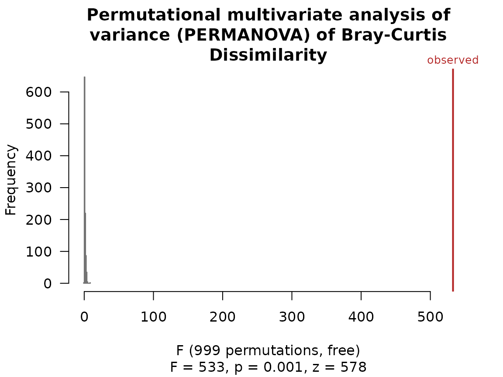
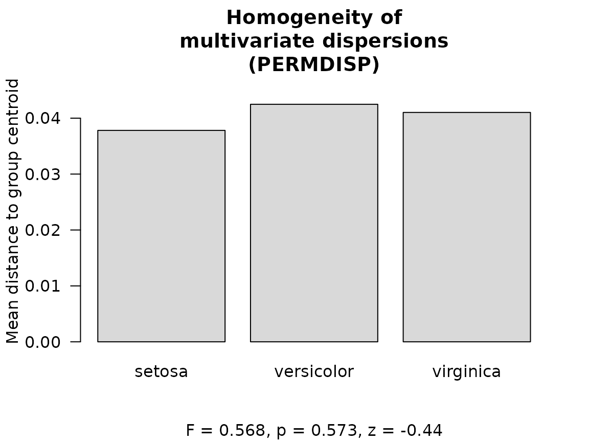
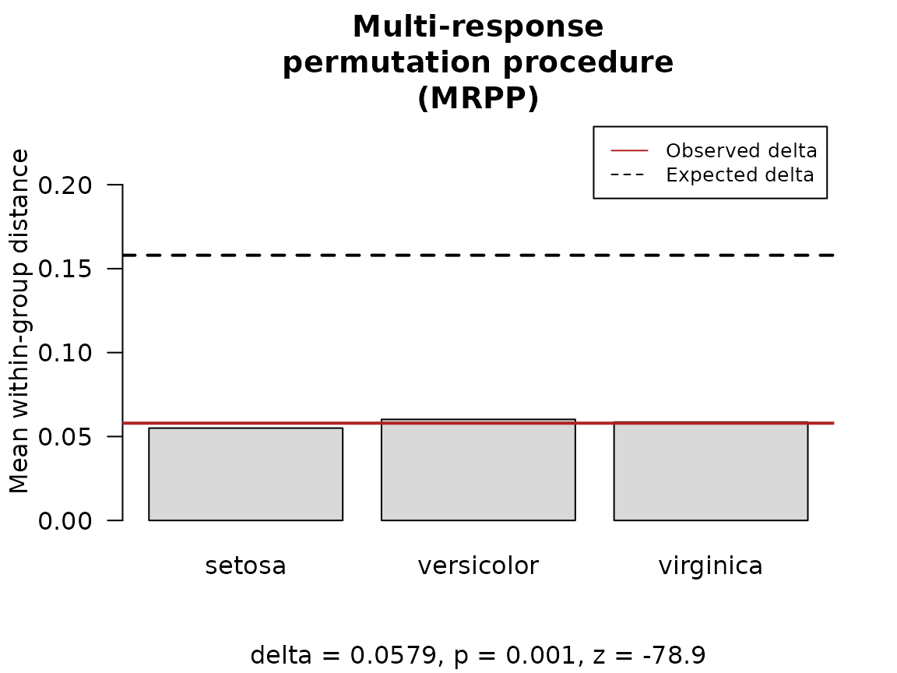
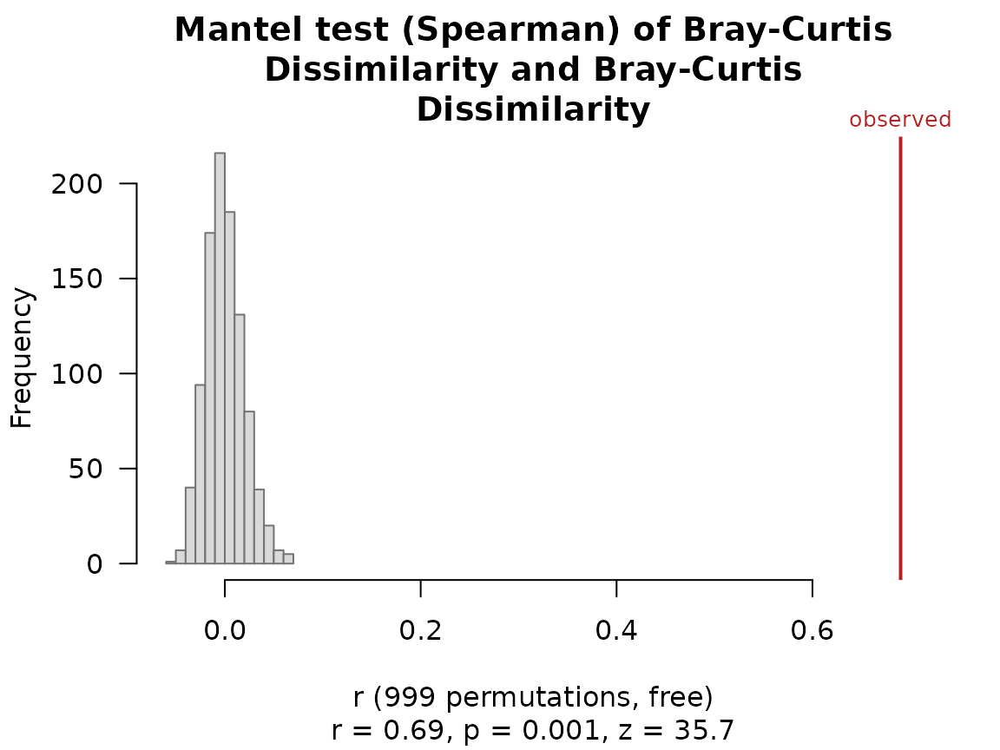
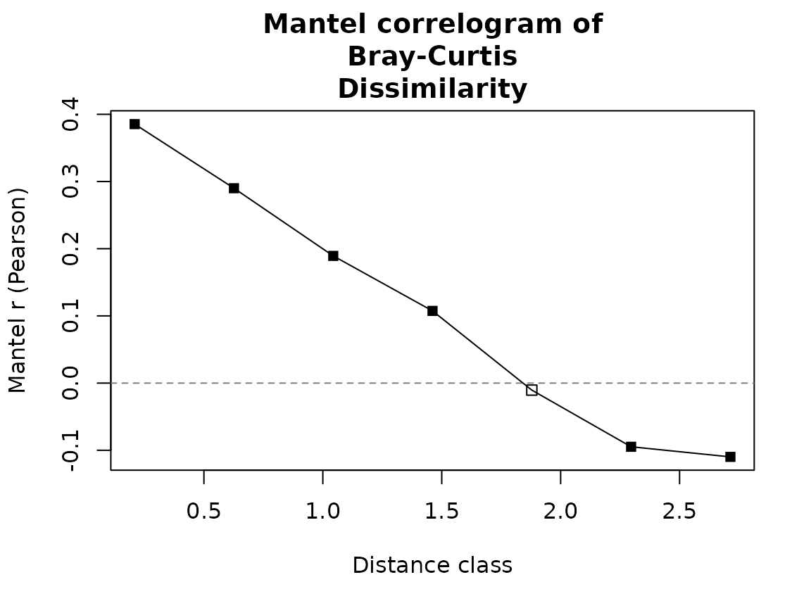
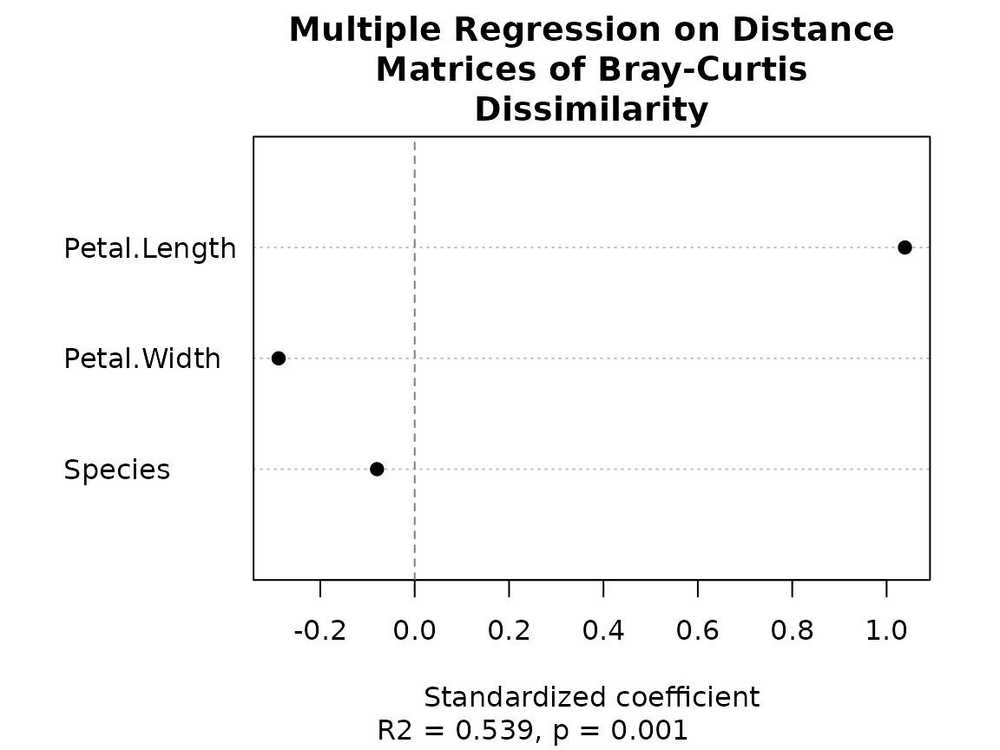

# Statistical Tests

## Introduction

An ordination plot can suggest that groups of samples differ. ecodive’s
permutation tests check whether the difference is real: does a variable,
such as treatment or body site, explain the distances between samples?

Each test takes a distance matrix (`dm`) from any beta diversity metric,
plus the variable to test: either a vector with one value per sample, or
the name of a column in a data frame of sample metadata (`data`).

| Function | Test | Variable | Question |
|:---|:---|:---|:---|
| [`permanova()`](https://cmmr.github.io/ecodive/reference/permanova.md) | Permutational Multivariate Analysis of Variance | either | Do group centroids differ? How much variance (R²) does it explain? |
| [`permdisp()`](https://cmmr.github.io/ecodive/reference/permdisp.md) | Homogeneity of Multivariate Dispersions | categorical | Do groups differ in their spread? |
| [`anosim()`](https://cmmr.github.io/ecodive/reference/anosim.md) | Analysis of Similarities | categorical | Are distances within groups smaller than between them (ranks)? |
| [`mrpp()`](https://cmmr.github.io/ecodive/reference/mrpp.md) | Multi-Response Permutation Procedure | categorical | Are distances within groups smaller than expected? |
| [`mantel()`](https://cmmr.github.io/ecodive/reference/mantel.md) | Mantel Test | numeric | Do distances correlate with differences in a numeric variable, or with another distance matrix? |
| [`mantel_partial()`](https://cmmr.github.io/ecodive/reference/mantel_partial.md) | Partial Mantel Test | numeric | Do they still, after removing the effect of a third distance matrix? |

They give the same statistics as `vegan`’s `adonis2()`, `betadisper()`,
[`anosim()`](https://cmmr.github.io/ecodive/reference/anosim.md),
[`mrpp()`](https://cmmr.github.io/ecodive/reference/mrpp.md),
[`mantel()`](https://cmmr.github.io/ecodive/reference/mantel.md), and
`mantel.partial()`, with permutations run in parallel C, and the
p-values are identical for any number of threads.

The examples use R’s built-in `iris` data, as in
[`vignette('ordination')`](https://cmmr.github.io/ecodive/articles/ordination.md):
150 flowers, four measurements each, and three species.

``` r

library(ecodive)

dm <- bray(iris[, 1:4])
```

## PERMANOVA

[`permanova()`](https://cmmr.github.io/ecodive/reference/permanova.md)
is the most widely used test. Give the grouping variable as a column
name of `data`, or as a vector.

``` r

res <- permanova(dm, 'Species', iris)
res
#> Permutational multivariate analysis of variance (PERMANOVA) of Bray-Curtis Dissimilarity
#> 
#> F = 532.7, p = 0.001, z = 577.6
#> Permutations: 999 (free)
#> 
#> Model R2 = 0.8788. Model tested as a whole:
#> 
#>           Df SumOfSqs     R2     F Pr(>F)    
#> Model      2   2.3173 0.8788 532.7  0.001 ***
#> Residual 147   0.3197 0.1212                 
#> Total    149   2.6370 1.0000                 
#> ---
#> Signif. codes:  0 '***' 0.001 '**' 0.01 '*' 0.05 '.' 0.1 ' ' 1
```

Species explain most of the variation between flowers (`R2`), and no
permutation of the labels did as well (`p`). The p-value cannot be
smaller than 1 / (`permutations` + 1), so use more permutations for a
more precise one.

[`plot()`](https://rdrr.io/r/graphics/plot.default.html) shows the
pseudo-F of every permutation, and the observed one far beyond them:

``` r

plot(res)
```



A `formula` tests several variables at once. `by = 'terms'` tests each
in turn, as `adonis2()` does, and `strata` restricts permutations to
within blocks (such as subjects in a repeated-measures design).

``` r

permanova(dm, data = iris, formula = ~ Species + Sepal.Width, by = 'terms')
#> Permutational multivariate analysis of variance (PERMANOVA) of Bray-Curtis Dissimilarity
#> 
#> F =   825, p = 0.001, z =  1105
#> Permutations: 999 (free)
#> 
#> Model R2 = 0.9443. Terms added sequentially (first to last):
#> 
#>              Df SumOfSqs     R2      F Pr(>F)    
#> Species       2   2.3173 0.8788 1151.7  0.001 ***
#> Sepal.Width   1   0.1728 0.0655  171.8  0.001 ***
#> Residual    146   0.1469 0.0557                  
#> Total       149   2.6370 1.0000                  
#> ---
#> Signif. codes:  0 '***' 0.001 '**' 0.01 '*' 0.05 '.' 0.1 ' ' 1
```

## Checking the spread

PERMANOVA can also give a small p-value when groups have the same center
but different spreads.
[`permdisp()`](https://cmmr.github.io/ecodive/reference/permdisp.md)
tests the spread on its own; a significant result means a PERMANOVA
difference may come partly or wholly from dispersion.

``` r

res <- permdisp(dm, 'Species', iris)
#> Warning: Some squared distances to group centres are negative, and were set to
#> 0.
res
#> Homogeneity of multivariate dispersions (PERMDISP) of Bray-Curtis Dissimilarity
#> 
#> F = 0.5676, p = 0.573, z = -0.4401
#> Permutations: 999 (free)
#> 
#> Distances to group centroids:
#>     setosa versicolor  virginica 
#>    0.03781    0.04248    0.04103 
#> 
#>            Df  Sum Sq   Mean Sq     F N.Perm Pr(>F)
#> Groups      2 0.00057 0.0002852 0.568    999  0.573
#> Residuals 147 0.07386 0.0005024
plot(res)
```



Here the three species are equally spread, so the PERMANOVA result above
reflects a real difference in their centers. The warning comes from
Bray-Curtis distances not being Euclidean: a flower can then sit at a
negative squared distance from its species’ center, which
[`permdisp()`](https://cmmr.github.io/ecodive/reference/permdisp.md)
sets to zero (Anderson 2006).

## ANOSIM and MRPP

[`anosim()`](https://cmmr.github.io/ecodive/reference/anosim.md)
compares the ranks of distances within and between groups. `R` near 1
means every group is distinct, and near 0 means no difference.
[`mrpp()`](https://cmmr.github.io/ecodive/reference/mrpp.md) compares
the average distance within groups with what random groups would give.

``` r

anosim(dm, 'Species', iris)
#> Analysis of similarities (ANOSIM) of Bray-Curtis Dissimilarity
#> 
#> R = 0.8576, p = 0.001, z =  79.4
#> Permutations: 999 (free)
#> 
#> Mean rank of the distances, between and within groups:
#>            pairs mean_rank
#> Between     7500   7163.90
#> setosa      1225   2239.66
#> versicolor  1225   2457.85
#> virginica   1225   2418.15

res <- mrpp(dm, 'Species', iris)
res
#> Multi-response permutation procedure (MRPP) of Bray-Curtis Dissimilarity
#> 
#> delta = 0.05795, p = 0.001, z = -78.9
#> Permutations: 999 (free)
#> 
#> Mean within-group distances (weights: n):
#>        setosa versicolor virginica
#> delta 0.05502     0.0602   0.05861
#> n          50         50        50
#> 
#> Expected delta: 0.158
#> Chance-corrected within-group agreement A: 0.6332
```

[`plot()`](https://rdrr.io/r/graphics/plot.default.html) of an MRPP
result shows each group’s mean within-group distance, with their
weighted mean (the observed \delta) and the mean of all distances (the
\delta expected by chance); `type = 'null'` shows the permutations
instead, as for the other tests.

``` r

plot(res)
```



## Pairwise comparisons

When an overall test finds that the groups differ, the next question is
usually which ones. `pairwise = TRUE` reruns the test on each pair of
groups’ samples, and adjusts the pairs’ p-values for multiple testing
(Holm’s method by default; `p_adjust = 'BH'` controls the false
discovery rate instead). The overall result is unchanged.

``` r

res <- permanova(dm, 'Species', iris, pairwise = TRUE)
res$pairwise
#>                               F        R2         z   n n_perm p_value
#> setosa-versicolor     552.51266 0.8493496 412.88785 100    999   0.001
#> setosa-virginica     1001.54509 0.9108722 688.94049 100    999   0.001
#> versicolor-virginica   91.82959 0.4837475  75.54295 100    999   0.001
#>                      p_adjusted
#> setosa-versicolor         0.003
#> setosa-virginica          0.003
#> versicolor-virginica      0.003
```

`p_value` is each pair’s own permutation p-value, and `p_adjusted` the
value to report.
[`anosim()`](https://cmmr.github.io/ecodive/reference/anosim.md) and
[`mrpp()`](https://cmmr.github.io/ecodive/reference/mrpp.md) take the
same arguments, and
[`permdisp()`](https://cmmr.github.io/ecodive/reference/permdisp.md)
adds adjusted p-values to its pairwise t tests:

``` r

permdisp(dm, 'Species', iris, pairwise = TRUE)$pairwise
#> Warning: Some squared distances to group centres are negative, and were set to
#> 0.
#>                               t Df          z   n n_perm   p_value p_value_perm
#> setosa-versicolor    -1.0328277 98 -1.0325057 100    999 0.3042267        0.294
#> setosa-virginica     -0.7327500 98 -0.7079531 100    999 0.4654599        0.471
#> versicolor-virginica  0.3204074 98  0.2900848 100    999 0.7493417        0.764
#>                      p_adjusted p_adjusted_perm
#> setosa-versicolor     0.9126800           0.882
#> setosa-virginica      0.9309198           0.942
#> versicolor-virginica  0.9309198           0.942
```

## Mantel test

[`mantel()`](https://cmmr.github.io/ecodive/reference/mantel.md)
correlates `dm` with a numeric variable, or with a second distance
matrix: here, whether flowers with similar petals also have similar
sepals. `method` can be `'pearson'`, `'spearman'`, or `'kendall'`.

``` r

sepals <- bray(iris[, 1:2])
petals <- bray(iris[, 3:4])

res <- mantel(sepals, petals, method = 'spearman')
res
#> Mantel test (Spearman) of Bray-Curtis Dissimilarity and Bray-Curtis Dissimilarity
#> 
#> r =  0.69, p = 0.001, z = 35.65
#> Permutations: 999 (free)
#> 
#> Correlation: Spearman's rank correlation rho
#> Alternative: greater (r is more positive than by chance)
#> Samples: 150
plot(res)
```



[`mantel_partial()`](https://cmmr.github.io/ecodive/reference/mantel_partial.md)
removes the effect of a third set of distances, `given`: here, whether
sepals and petals still match after accounting for petal width alone.

``` r

mantel_partial(sepals, petals, given = 'Petal.Width', data = iris, method = 'spearman')
#> Partial Mantel test (Spearman) of Bray-Curtis Dissimilarity and Bray-Curtis Dissimilarity
#> 
#> r = 0.3918, p = 0.001, z =  12.4
#> Permutations: 999 (free)
#> 
#> Correlation: Spearman's rank correlation rho
#> Alternative: greater (r is more positive than by chance)
#> Samples: 150
```

[`mantel_correlogram()`](https://cmmr.github.io/ecodive/reference/mantel_correlogram.md)
splits the pairs of samples into classes by a second distance, usually
geographic, and runs a Mantel test for each class: how similarity
changes with distance. Here, petal measurements stand in for
coordinates: flowers with close petals have similar sepals (a positive
statistic), and those with distant petals dissimilar ones.

``` r

res <- mantel_correlogram(sepals, iris[, 3:4])
res
#> # A data.frame: 15 × 7
#> # Mantel correlogram of Bray-Curtis Dissimilarity
#>    class_from class_to class_mid n_pairs       r p_value p_adjusted
#>         <dbl>    <dbl>     <dbl>   <int>   <dbl>   <dbl>      <dbl>
#>  1      0        0.418     0.209    1987  0.385    0.001      0.001
#>  2      0.418    0.835     0.626    1383  0.29     0.001      0.002
#>  3      0.835    1.25      1.04      987  0.189    0.001      0.003
#>  4      1.25     1.67      1.46      795  0.107    0.001      0.004
#>  5      1.67     2.09      1.88      648 -0.0104   0.24       0.24
#>  6      2.09     2.51      2.3       565 -0.0948   0.001      0.006
#>  7      2.51     2.92      2.71      791 -0.11     0.001      0.007
#>  8      2.92     3.34      3.13      793 NA       NA         NA
#>  9      3.34     3.76      3.55      798 NA       NA         NA
#> 10      3.76     4.18      3.97      761 NA       NA         NA
#> 11      4.18     4.59      4.38      672 NA       NA         NA
#> 12      4.59     5.01      4.8       560 NA       NA         NA
#> 13      5.01     5.43      5.22      263 NA       NA         NA
#> 14      5.43     5.85      5.64      140 NA       NA         NA
#> 15      5.85     6.26      6.05       32 NA       NA         NA
#> # Attributes: breaks, method, alternative, p_adjust, progressive, n_perm,
#> #   permutation, r_perm
plot(res)
```



[`mantel_regression()`](https://cmmr.github.io/ecodive/reference/mantel_regression.md)
regresses `dm` on several distance matrices at once (multiple regression
on distance matrices, MRM), with a permutation p-value for each term and
for the whole model: here, which of petal length, petal width and
species explains the differences in sepals. A numeric column’s distances
are its differences, and a factor’s are 0 (same species) or 1
(different).

``` r

res <- mantel_regression(sepals ~ Petal.Length + Petal.Width + Species, data = iris)
res
#> Multiple Regression on Distance Matrices of Bray-Curtis Dissimilarity
#> 
#> R2 = 0.5388, F = 4350, p = 0.001
#> Permutations: 999 (free)
#> Regression: least squares on the distances
#> Samples: 150 (11175 pairs)
#> 
#>          term  estimate std_estimate      t p_value
#>   (Intercept)   0.04423               88.77   1.000
#>  Petal.Length   0.02926        1.039  65.36   0.001
#>   Petal.Width  -0.01933      -0.2884 -17.85   0.001
#>       Species -0.007284     -0.07981 -8.541   0.001
plot(res)
```



## Running tests by name

[`dist_test()`](https://cmmr.github.io/ecodive/reference/dist_test.md)
runs any test by name, as
[`dist_ord()`](https://cmmr.github.io/ecodive/reference/dist_ord.md)
does for ordinations. It checks that the variable suits the test
(categorical or numeric), and names are matched forgivingly: `'adonis2'`
finds `permanova` and `'betadisper'` finds `permdisp`.

``` r

dist_test(dm, 'adonis2', 'Species', iris)
#> Permutational multivariate analysis of variance (PERMANOVA) of Bray-Curtis Dissimilarity
#> 
#> F = 532.7, p = 0.001, z = 577.6
#> Permutations: 999 (free)
#> 
#> Model R2 = 0.8788. Model tested as a whole:
#> 
#>           Df SumOfSqs     R2     F Pr(>F)    
#> Model      2   2.3173 0.8788 532.7  0.001 ***
#> Residual 147   0.3197 0.1212                 
#> Total    149   2.6370 1.0000                 
#> ---
#> Signif. codes:  0 '***' 0.001 '**' 0.01 '*' 0.05 '.' 0.1 ' ' 1
```

Each result converts to a one-row data frame with the same columns, so
several tests combine into one table.

``` r

tests <- list_dist_tests(val = 'id', groups = 'categorical')

do.call(rbind, lapply(tests, function (test)
  as.data.frame(dist_test(dm, test, 'Species', iris)) ))
#> Warning: Some squared distances to group centres are negative, and were set to
#> 0.
#>        test stat_name    statistic p_value           z n_perm
#> 1    anosim         R   0.85763011   0.001  79.3963367    999
#> 2      mrpp     delta   0.05794548   0.001 -78.9020283    999
#> 3 permanova         F 532.74262193   0.001 577.5590509    999
#> 4  permdisp         F   0.56763808   0.573  -0.4401028    999
```

## Reproducibility

Permutations come from ecodive’s own random number generator, set by
`seed` (default `0`), so the same call always gives the same p-value, on
any computer and with any number of `cpus`. R’s
[`set.seed()`](https://rdrr.io/r/base/Random.html) has no effect.

``` r

identical(
  permanova(dm, 'Species', iris, seed = 1, cpus = 1),
  permanova(dm, 'Species', iris, seed = 1, cpus = 2) )
#> [1] TRUE
```
